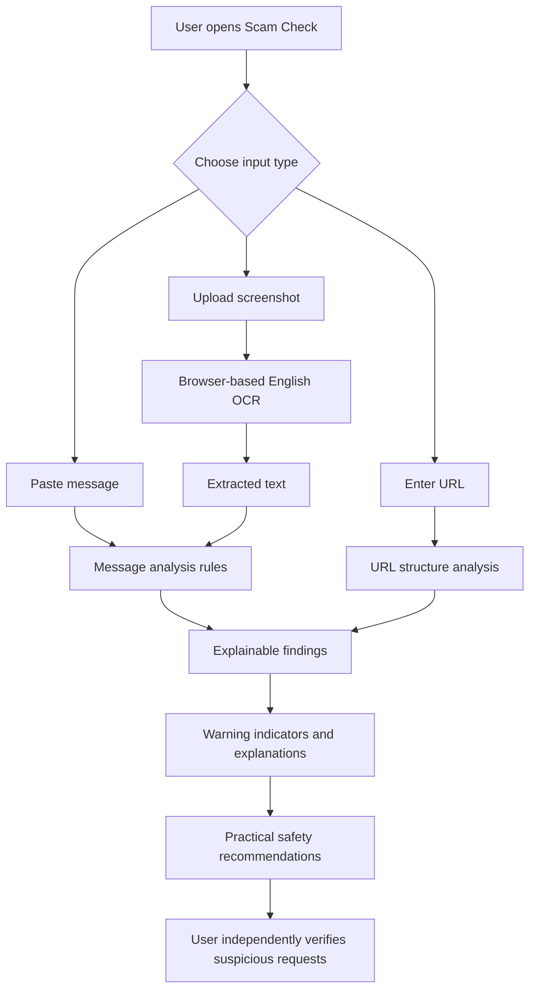

# FORWARD?

### Think before you click.

FORWARD? is a privacy-conscious scam-awareness assistant that helps people review suspicious messages, web addresses, and screenshots. It highlights explainable warning indicators and provides practical next steps to help users make more informed decisions before acting.

It is designed around one simple principle: **pause, examine, and verify before you trust.**

> [!IMPORTANT]
> FORWARD? is a scam-awareness prototype, not a guaranteed scam detector. Its findings are based on local heuristic rules. A warning does not prove fraud, and the absence of warnings does not establish that something is safe.

**Live demo:** Coming soon — deployment pending.

**Built with:** React 19 · TypeScript 7 · Vite 8 · React Router 7 · Tesseract.js 7

---

## Table of Contents

- [FORWARD?](#forward)
    - [Think before you click.](#think-before-you-click)
  - [Table of Contents](#table-of-contents)
  - [Product Overview](#product-overview)
    - [Our Approach](#our-approach)
  - [Screenshots](#screenshots)
  - [Features](#features)
    - [1. Scam Check — Available](#1-scam-check--available)
    - [2. Explainable Results](#2-explainable-results)
    - [3. Coming Soon](#3-coming-soon)
  - [How It Works](#how-it-works)
    - [Analysis Process](#analysis-process)
  - [Privacy and Security](#privacy-and-security)
  - [Technology Stack](#technology-stack)
  - [Getting Started](#getting-started)
    - [Prerequisites](#prerequisites)
    - [Installation](#installation)
    - [Run Locally](#run-locally)
  - [Testing and Quality Checks](#testing-and-quality-checks)
    - [Automated Tests](#automated-tests)
    - [Production Preview](#production-preview)
  - [Project Structure](#project-structure)
  - [Limitations](#limitations)
  - [Documentation](#documentation)
  - [Future Improvements](#future-improvements)
  - [License](#license)

---

## Product Overview

Online scams increasingly imitate familiar organisations, create artificial urgency, and exploit people's trust.

FORWARD? provides a place where users can examine suspicious messages, links, and screenshots before taking action.

Instead of presenting a simple suspicious/safe verdict, the application highlights identifiable warning indicators, explains why they may matter, and suggests practical steps for independent verification.

### Our Approach

- **Awareness over assumptions:** Help users recognise suspicious patterns rather than blindly trust a verdict.
- **Explainability:** Show the indicators behind an analysis.
- **Privacy-conscious processing:** Perform message and URL analysis locally in the browser.
- **Practical guidance:** Encourage users to verify unexpected requests through trusted, independent channels.

---

## Screenshots

Application screenshots will be added here after deployment and manual verification.

<!-- Add genuine screenshots here. Example:


-->

---

## Features

### 1. Scam Check — Available

The primary implemented feature currently supports three input methods.

| Input method | Functionality |
|---|---|
| Message analysis | Reviews pasted SMS, chat, and email text for contextual warning indicators. |
| URL analysis | Examines the structure of a submitted web address without visiting it. |
| Screenshot analysis | Extracts English text from an uploaded screenshot using browser-based OCR, then analyses the extracted text. |

### 2. Explainable Results

- Displays identified warning indicators.
- Provides evidence and plain-language explanations.
- Separates different levels of concern and informational observations.
- Offers practical safety recommendations.
- Communicates uncertainty and limitations.

### 3. Coming Soon

| Feature | Status | Planned purpose |
|---|---|---|
| Scam Arena | Coming Soon | Interactive scam-awareness practice scenarios. |
| Family Shield | Coming Soon | Family-focused scam-awareness tools. |

These are currently placeholder pages, not implemented product features.

---

## How It Works

FORWARD? follows a local-first analysis workflow.



### Analysis Process

**Message analysis**

Pasted text is examined using contextual, rule-based checks. The analyzer looks for identifiable warning patterns and produces explainable findings.

**URL analysis**

The submitted URL is parsed locally and checked for selected structural characteristics, including suspicious patterns in its address.

The analyzer does not visit the submitted URL, expand shortened links, or query live website-reputation databases.

**Screenshot analysis**

An uploaded screenshot is processed using Tesseract.js in a browser worker. Extracted English text is passed to the message analyzer.

OCR can misread text, and real screenshot OCR has not yet been verified in standard Chrome.

**Results**

The application presents findings, explanations, and practical recommendations. Users are encouraged to verify unexpected requests independently through official websites, applications, or contact channels they already trust.

---

## Privacy and Security

Privacy-conscious processing is an important design consideration in FORWARD?.

- **Message processing:** Message analysis runs locally in the browser.
- **URL processing:** URL parsing and structural analysis run locally. Submitted URLs are not visited by the analyzer.
- **Screenshot processing:** OCR runs in a browser worker. The application has no backend or application-controlled screenshot upload endpoint.
- **Temporary handling:** Selected screenshots are held transiently for analysis.
- **External resources:** Tesseract runtime and English language resources may be downloaded when OCR is first used.
- **Fonts:** The global stylesheet loads fonts from Google Fonts.

> Local processing does not mean that the browser makes no external network requests. These statements describe the application's source and configured behavior, not an independent network-level security certification.

For further details, see [Privacy Notes](docs/PRIVACY.md).

---

## Technology Stack

Versions below represent the declared package ranges in `package.json`.

| Area | Technology |
|---|---|
| Frontend | React `^19.3.1` |
| Language | TypeScript `~7.0.2` |
| Build tool | Vite `^8.3.6` |
| Routing | React Router DOM `^7.18.6` |
| Screenshot OCR | Tesseract.js `^7.0.0` |
| React integration | `@vitejs/plugin-react` `^6.1.2` |
| Linting | Oxlint `^1.90.0` |
| Testing | Node.js built-in test runner |
| Styling | CSS |

---

## Getting Started

### Prerequisites

- Node.js compatible with Vite 8 (Node.js `20.19+` or `22.12+` recommended).
- npm.
- Git.

### Installation

Clone the repository:

```bash
git clone https://github.com/ishritaggarwal2307/FORWARD.git
```

Navigate into the project:

```bash
cd FORWARD
```

Install dependencies:

```bash
npm install
```

For reproducible installation using the lockfile, you can alternatively run:

```bash
npm ci
```

### Run Locally

Start the development server:

```bash
npm run dev
```

Open the local URL displayed in your terminal. Vite normally uses:

```text
http://localhost:5173
```

The application does not require a backend or environment variables for local development.

---

## Testing and Quality Checks

Run the following commands from the project directory:

```bash
npm test
npm run build
npm run lint
git diff --check
```

### Automated Tests

The current automated test suite contains **148 passing tests**.

These tests cover implemented analysis rules and error handling. They do not establish real-world scam-detection accuracy.

OCR tests use mocked workers and do not verify real screenshot OCR in a standard browser.

For additional testing instructions, see [Testing and Local QA](docs/TESTING.md).

### Production Preview

After building the application, run:

```bash
npm run preview
```

This serves the production build locally.

---

## Project Structure

```text
FORWARD/
├── src/
│   ├── App.tsx
│   ├── App.css
│   ├── index.css
│   ├── main.tsx
│   ├── components/
│   │   └── SiteHeader.tsx
│   ├── pages/
│   │   └── HomePage.tsx
│   └── features/
│       └── scam-check/
│           ├── ScamCheckPage.tsx
│           ├── ScamCheck.css
│           ├── components/
│           │   ├── InputMethodPicker.tsx
│           │   └── ScreenshotUpload.tsx
│           └── analysis/
│               ├── analyzeText.ts
│               ├── analyzeUrl.ts
│               ├── analyzeScreenshot.ts
│               ├── results.ts
│               └── types.ts
├── tests/
│   └── scam-check-analysis.test.mjs
├── docs/
│   ├── ARCHITECTURE.md
│   ├── PRIVACY.md
│   └── TESTING.md
├── DESIGN.md
├── README.md
├── package.json
└── package-lock.json
```

---

## Limitations

FORWARD? is an early-stage prototype. Its capabilities have important limitations:

- Detection relies on local heuristic rules and can miss new scam patterns, paraphrases, context, and multilingual content.
- Legitimate messages may trigger warning indicators.
- The analyzer does not verify sender identity, contact banks or delivery services, or prove that a message is fraudulent.
- URL checks are structural. They do not establish website reputation or determine whether a destination is malicious.
- Registered-domain estimation relies on a small local suffix list rather than a complete public-suffix database.
- Screenshot OCR supports English and may misread small, blurry, stylized, handwritten, or otherwise difficult text.
- OCR readability is not a scam-risk score.
- Real screenshot OCR has not yet been verified in standard Chrome.
- Tesseract may download its worker and language resources when OCR is first used.
- Scam Arena and Family Shield are not implemented yet.

---

## Documentation

Additional technical documentation is available:

| Document | Description |
|---|---|
| [Architecture](docs/ARCHITECTURE.md) | Application structure, routes, and analysis flow. |
| [Privacy Notes](docs/PRIVACY.md) | Privacy-related implementation details and limitations. |
| [Testing and Local QA](docs/TESTING.md) | Automated checks and manual testing procedures. |
| [Design Direction](DESIGN.md) | Product design, visual identity, and feature status. |

---

## Future Improvements

Potential areas of improvement include:

- Validate screenshot OCR using real images in standard browsers.
- Expand the independently reviewed scam-message test corpus.
- Evaluate detection performance against clearly labelled legitimate and suspicious examples.
- Improve URL domain analysis with a more complete public-suffix implementation.
- Evaluate multilingual text and OCR support.
- Conduct accessibility and usability testing.
- Explore additional scam-awareness features while preserving explainability and privacy-conscious processing.

Future development should prioritise measurable improvements rather than adding features without validation.

---

## License

No license is currently specified in this repository.